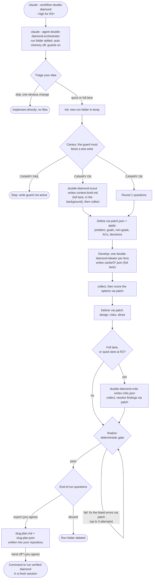

# double-diamond for Claude Code

A feature-**planning** workflow for Claude Code. It turns a feature idea into a validated, decision-recorded plan using the Double Diamond:
- **Discover** and **Define**: diverge, then converge on the problem.
- **Develop** and **Deliver**: diverge, then converge on the solution.

The strongest model works only at decision points, cheap tiers do the rest, and a deterministic gate checks the result. The package is self-contained: Claude Code and Python are all it needs.

## How it works
The lead (`double-diamond-orchestrator`) makes every decision and asks you only what it can't look up. Cheaper workers each write one file into the run folder; the plan script merges their files, keeps the evidence, and runs the gate.



The same flow without Mermaid, with the run folder and what each seat's write guard allows:
```
you  -->  claude --workflow double-diamond  -->  launch.ps1 / launch.sh  -->  claude --agent double-diamond-orchestrator
      -->  init  -->  run folder in your temp directory  (canary: the guard must block a test write)

<temp>/double-diamond/<run-id>/         written by
    plan.json                           dd_plan.py only (apply, collect, finalize)
    patch.json                          double-diamond-orchestrator; apply merges it, then deletes it
    context-brief.md                    double-diamond-scout
    cards/O1.json, O2.json, ...         double-diamond-ideator, one per lens
    critic.json                         double-diamond-critic
    PLAN.md                             dd_plan.py (render, finalize)
    history/                            dd_plan.py (revise)

  Discover            Define              Develop             Deliver             Gate               End of run
+-----------+       +-----------+       +-----------+       +-----------+       +-----------+       +--------------------+
| scout:    |       | ACs and   |       | ideator:  |       | design,   |       | finalize  |       | export? (asks)     |
| brief +   | ----> | decisions | ----> | cards +   | ----> | risks,    | ----> | PASS: done|  ---> | hand off? (asks)   |
| questions |       | (patch)   |       | scores    |       | slices,   |       | FAIL: fix |       | or discard the run |
|           |       |           |       |           |       | critic    |       | by patch  |       |                    |
+-----------+       +-----------+       +-----------+       +-----------+       +-----------+       +--------------------+
```

## Contents
```
workflows/double-diamond/
    README.md                this file (also installed as ~/.claude/double-diamond/README.md)
    workflow.json            name, version, orchestrator agent, skill and launcher (shared workflow format)
    MANIFEST.json            every installed file with its SHA-256 (generated by tools/update_manifest.py)
    DESIGN.md                design contract for maintainers (not installed)
    tests/smoke_test.py      end-to-end check of the guard, CLI and gate (not installed)
    payload/                 installed as-is into ~/.claude
        agents/double-diamond-orchestrator.md       opus, medium effort    lead: triage, questions, convergence, design
        agents/double-diamond-orchestrator-high.md  opus, high effort      same lead for R3+ plans
        agents/double-diamond-scout.md              haiku                  one read-only repo context brief
        agents/double-diamond-ideator.md            sonnet, medium effort  one option per lens
        agents/double-diamond-critic.md             sonnet, high effort    pre-mortem (always in the full lane, at R2 in the quick lane)
        skills/double-diamond/   SKILL.md, references/, assets/, scripts/ (dd_plan.py, plan_core.py, guard_write.py, launch.ps1, launch.sh)
```

## Models and budgets
Model and effort live in each agent's frontmatter; the strongest model works only at decision points, and the critic runs on a different model from the lead so their blind spots differ.

| Seat | Model | Effort | Max turns | When | Escalation |
|---|---|---|---|---|---|
| double-diamond-orchestrator | opus | medium | - | triage, questions, framing, convergence, design, slicing, final call | R3+ plans: start with `-High` (double-diamond-orchestrator-high, high effort) |
| double-diamond-scout | haiku | (not set) | 30 | one read-only context brief per plan | if the brief comes back thin on a large or unusual repository, re-run it once on sonnet |
| double-diamond-ideator | sonnet | medium | 12 | full lane only, 2-3 lenses in parallel | re-run a failed ideator once; after a second failure continue while two lenses remain, or the lead writes the option by patch |
| double-diamond-critic | sonnet | high | 20 | always in the full lane, at R2 in the quick lane | a second pass only if a blocker changed the chosen option or a contract |

Budgets (enforced by the skill text and the gate): at most 3 question rounds of 4 questions (2-4 options each), plus one round for critic blockers and the end-of-run round; 2-3 ideators; at most 2 critic passes and 10 findings; up to 3 finalize attempts; brief about 600 words, option card under 350 words.

## Requirements
- Claude Code with subagent `effort`, `maxTurns`, `hooks`, `skills` and `omitClaudeMd` frontmatter support. `omitClaudeMd` needs v2.1.271+.
- Python 3.9+ as `python3` on PATH (standard library only), for the plan script, the write-guard hooks and the launcher guard self-test. On Windows, `python3` may be the Microsoft Store alias stub, which the launcher detects and refuses; install Python or disable the alias in Settings > Apps > Advanced app settings > App execution aliases.
- Access to `opus`, `sonnet` and `haiku`.

## Install
From the repository root (see the [repository README](../../README.md) for details):
```sh
python3 install.py double-diamond --dry-run   # preview
python3 install.py double-diamond             # install into ~/.claude
python3 install.py --shell                    # once: makes `claude --workflow <name>` work in your terminal
```
The installer checks the payload against MANIFEST.json, skips identical files, and stops **before writing anything** if an existing file differs (re-run with `--force` to replace it; a copy is kept in `~/.claude/backups/`). If `~/.claude/skills/double-diamond` is a link (junction or symbolic link), it refuses to write through it and replaces only the link with `--force`; the link's target is never touched. Files from the previous layout (`agents/dd-*.md`, `dd-claude.*` launchers) are retired to the backups folder when unmodified.

Nothing needs adding to `settings.json`: the launcher grants access to the run folder itself.

## Use
Start planning from your project folder:
```sh
claude --workflow double-diamond           # lead on opus (medium effort)
claude --workflow double-diamond --high    # R3+ plans: double-diamond-orchestrator-high (high effort)
```
Then describe the feature you want to plan. Extra arguments are passed on to `claude`. Without the shell integration, run the launcher directly: `python3 ~/.claude/scripts/claude-workflow.py double-diamond [--high]`.

`claude --workflow double-diamond` runs this workflow's own launcher (`skills/double-diamond/scripts/launch.ps1` on Windows, `launch.sh` elsewhere). It is the only supported entry point, because planning must run in the **main session** (subagents cannot ask you questions) and the launcher turns on the safety measures. The launcher:
- needs `python3` and `claude` on PATH, and the installed guard at `~/.claude/skills/double-diamond/scripts/guard_write.py`;
- runs a guard self-test with `python3` before starting claude, and refuses to start if it fails;
- starts `claude --agent double-diamond-orchestrator` (or `double-diamond-orchestrator-high`) with `--add-dir <runs folder>`, so the run folder is reachable; the agent preloads the `double-diamond` skill;
- passes a temporary `--settings` file that turns auto memory off and excludes your user `CLAUDE.md`, and sets `CLAUDE_CODE_DISABLE_AUTO_MEMORY=1` and `DD_LAUNCHER=1` for that process only.

A plain `/double-diamond` session has no write guards and is **unsupported**; the plan script warns when it was not started by the launcher.

Each plan lives in its own run folder in the system temp directory, and only the session that created it can resume it. Nothing reaches your repository until you agree to an export at the end of the run. Old run folders are swept after 72 hours. The old `~/.config/double-diamond` folder from version 1 is no longer used and can be deleted.

## Write guards
Each agent has `PreToolUse` hooks that run `skills/double-diamond/scripts/guard_write.py`:

| Seat | Write / Edit hook | Bash hook |
|---|---|---|
| planner, planner-high | only `patch.json` in a run folder | only `python3 "<dd_plan.py>" <command> ...` |
| scout | only `context-brief.md` | none (no Bash tool) |
| ideator | only `cards/O<n>.json` | none (no Bash tool) |
| critic | only `critic.json` | none (no Bash tool) |

The lead's hooks come from the frontmatter of the agent started with `--agent`, so Claude Code applies them to the whole session, including every worker's tool calls. The guard therefore applies the seat of the agent that made the call (the hook payload's `agent_type`), not the seat of the hook that fired, so a worker is never judged by the lead's rules. A subagent that is not a double-diamond worker is denied, and workers may not run Bash.

Guards fail closed: an unknown mode or an unreadable payload is denied. A blocked call gets a JSON `deny` decision. That works in both Git Bash and PowerShell; an exit code 2 would be rewritten to 1 by PowerShell, which Claude Code treats as non-blocking. The hooks call `$HOME/.claude/skills/...`, so install into the default `~/.claude`.

## Verify
The runtime checks are the launcher's guard self-test (it runs before claude starts) and the in-run canary (the guard must block a test write, or the lead stops).

For maintainers, `tests/smoke_test.py` (standard library only, not installed) exercises the write guard and the full CLI path (`init`, `apply`, `collect`, `finalize`, `export`, `verify`) in a throwaway runs folder and git repository. After every change, from the repository root:
```sh
python3 tools/update_manifest.py
python3 tools/check.py double-diamond
```

## Uninstall
```sh
python3 install.py double-diamond --uninstall
```
This removes only files listed in the installed MANIFEST.json, and keeps any you modified unless you pass `--force`.
