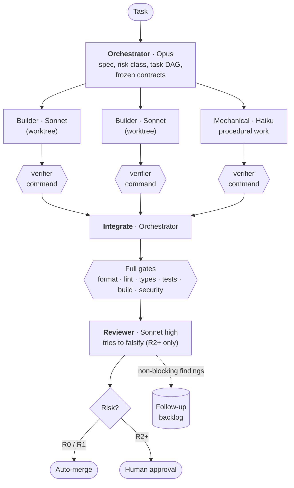
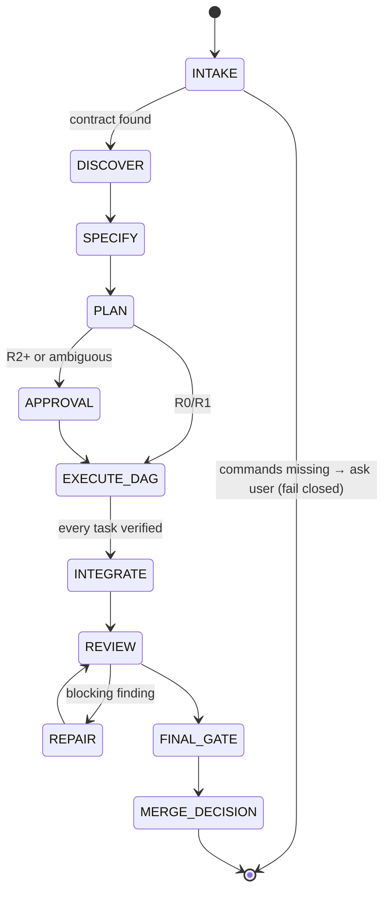
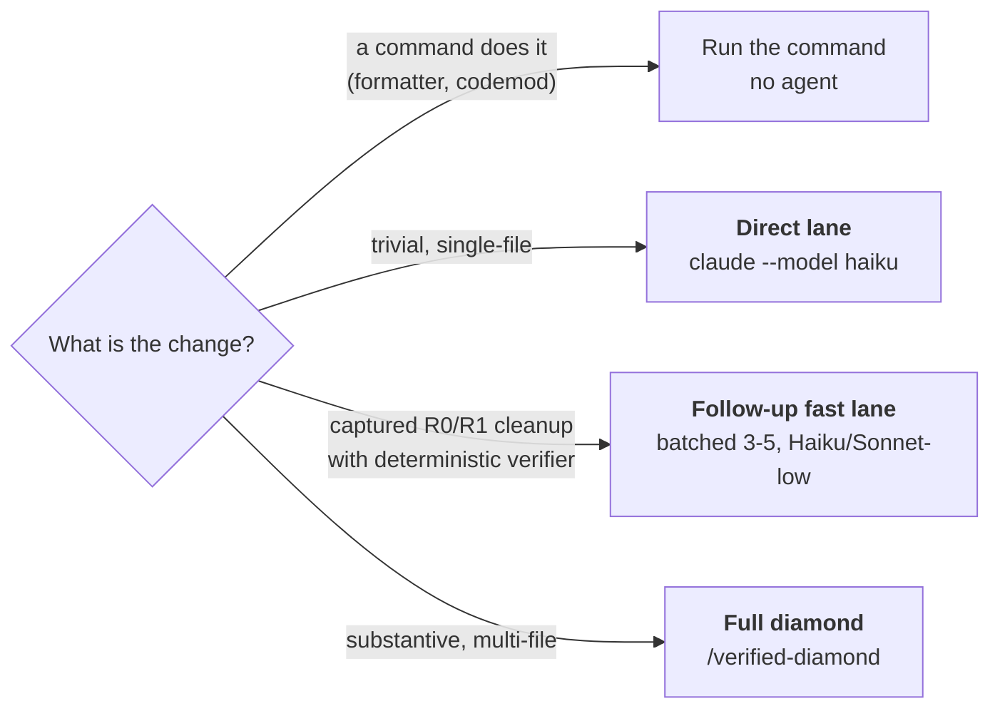

# Verified Diamond

A cost-aware orchestration workflow for Claude Code. An expensive model plans and integrates; cheaper models do bounded work in parallel; **deterministic commands (not model opinions) decide what passes**; an independent reviewer tries to break the result; risk level decides who approves the merge.

> **Fail-closed by design.** If your repo doesn't document its real install/lint/test/build commands, the pipeline stops and asks you to add them. It never invents commands.

## The idea: a diamond

Work fans out from one planner into parallel workers, then funnels back through verification and review into one decision.

Principles, in priority order: **deterministic program > mechanical (Haiku) > builder (Sonnet) > orchestrator (Opus)**. Ambiguity and integration stay with the orchestrator; only bounded, independently verifiable work is parallelized.

## Cast

| Role | Default model / effort | Job | Writes code? |
|---|---|---|---|
| Orchestrator | Opus / medium | Requirements, task DAG, contracts, routing, integration, repair, merge decision | Integration only |
| Builder | Sonnet / medium | One bounded task with a stable contract and local verifier; runs in an isolated git worktree | Yes |
| Mechanical | Haiku / low | Procedural, reversible work with an exact procedure and verifier (renames, codegen, config) | Yes |
| Explorer | Haiku / medium | Read-only repo mapping before planning | No |
| Reviewer | Sonnet / high (plan mode) | Adversarial review for correctness, security, data, concurrency, test quality | No |

Limits (in `routing.json`): max 3 builders, 4 mechanicals, 5 subagents total.

## State machine

Stop conditions: missing contract, two repeated failures, scope expansion, unavailable credentials, unresolved high finding, destructive action, or a human gate.

## Risk and approval

| Risk | Meaning | Merge |
|---|---|---|
| R0 | Docs, cosmetic | Auto-merge after all gates pass |
| R1 | Isolated code | Auto-merge after all gates pass, no protected paths touched |
| R2 | API, shared package, cache, queue | **Human approval** |
| R3 | Auth, schema, payments, infrastructure | **Human approval** |
| R4 | Production mutation, destructive, secret policy | **Human approval** |

## Lanes

**Follow-up fast lane.** Reviewers find nice-to-have cleanups. Instead of fixing them inline or leaving them as prose, the orchestrator records each as a complete task packet (`vd.py followup-add`) while context is hot. After the main run, qualifying packets (R0/R1, verifier fully covers the change, no protected path or shared contract) are drained in batches of 3-5 with no re-planning. Anything that fails qualification, or fails verification twice, is ejected to the full diamond.

See [`docs/WHEN-TO-USE.md`](docs/WHEN-TO-USE.md) for the full decision guide and [`docs/model-economics.md`](docs/model-economics.md) for the cost/quality rationale (estimates, not benchmarks).

## Safety

- A `PreToolUse` hook blocks a short list of destructive or exfiltration-prone operations (forced pushes, hard resets, infrastructure apply/destroy, cluster deletes, dropping databases, piping downloads into a shell) and reads or writes of secret-bearing paths (dotenv files, SSH keys, credential and private-key files). The exact patterns are in `payload/hooks/verified-diamond-policy.py`.
- Hook telemetry is metadata only (time, phase, tool name, success); never prompts, source, arguments, or output.
- State is scoped per project root under `~/.claude/verified-diamond/state/<project>-<hash>/`; worktrees of the same repo share it.
- No static hook can catch everything. Treat it as a backstop, not a sandbox. Note the hook scans the whole tool input, so it can also block *writing about* those operations (this README had to be reworded to get past it).

## What gets installed

| Repo path | Installed to `~/.claude/` | Purpose |
|---|---|---|
| `payload/agents/*.md` | `agents/` | The five subagents |
| `payload/skills/verified-diamond/` | `skills/verified-diamond/` | `/verified-diamond` skill and templates |
| `payload/hooks/verified-diamond-policy.py` | `hooks/` | Safety and audit hook |
| `payload/scripts/vd.py` | `scripts/` | State CLI (`init`, `add-task`, `ready`, `result`, `approve`, `status`, `followup-*`) |
| `payload/verified-diamond/routing.json` | `verified-diamond/` | Model routing, budgets, approval policy |
| `docs/` | `verified-diamond/docs/` | Decision guide, economics, evaluation plan |
| `payload/global-contract.md` | appended to `CLAUDE.md` | Global operating contract (marked block) |
| `payload/settings.fragment.json` | merged into `settings.json` | Permissions, env, hooks |

Routing policy lives in `routing.json`; tune models, effort, and limits there. When docs and `routing.json` disagree, `routing.json` wins.

## Validation

Run the same tasks with a single-Opus baseline and with Verified Diamond and compare; see [`docs/evaluation/README.md`](docs/evaluation/README.md).
